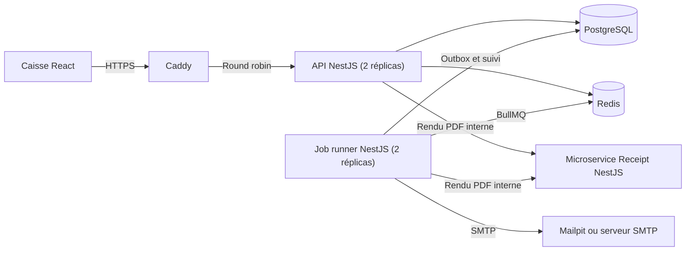

# Architecture et démonstration



| Application       | Responsabilité                                                                                                                           |
| ----------------- | ---------------------------------------------------------------------------------------------------------------------------------------- |
| `apps/front`      | Caisse React et client HTTP typé.                                                                                                        |
| `apps/api`        | Catalogue, inventaire, comptes, fidélité, panier, encaissement, émission des factures, API Swagger.                                      |
| `apps/receipt`    | Rendu PDF à partir d’un instantané de vente et d’une facture facultative. Ce service interne valide la requête et son jeton avant rendu. |
| `apps/job-runner` | Publication depuis PostgreSQL, traitement BullMQ, rendu et envoi SMTP.                                                                   |

Les contrats Zod et les calculs en centimes sont dans `packages/contracts`. Les transactions PostgreSQL et les contrats de travail du runner sont dans `packages/infra`. Les configurations TypeScript strictes et ESLint flat sont partagées dans `packages/tsconfig` et `packages/eslint`.

## Données et concurrence

- `catalog` et `inventory` ont pour clé le GENCOD. Le navigateur traite ce code comme une chaîne pour conserver ses zéros initiaux.
- `sales` appartient à un compte et peut référencer une carte de fidélité. Les index `sales_recent` et `sales_cashier_recent` servent aux deux accès à l’historique. `sale_lines` fige le prix TTC et le taux de TVA par article. Les totaux HT et TVA sont arrondis au centime par ligne.
- L’encaissement verrouille le panier et les lignes de stock dans l’ordre des GENCOD. Le paiement accepté, la mise à jour du stock et la clôture de vente sont validés dans la même transaction. Un index unique partiel interdit un deuxième paiement accepté sur la même vente. La même requête de paiement retourne la vente existante après une réponse perdue. Un paiement refusé est historisé et laisse le panier ouvert.
- `invoices` associe un seul numéro de facture à une vente. `deliveries` associe un seul suivi à une vente et à un type de document. Sa clé étrangère de vente évite la duplication. Le retrait d’une carte supprime l’association avec les ventes et bloque les futurs envois.
- Les comptes utilisent des mots de passe hachés avec scrypt et des JWT de huit heures. Chaque instance vérifie la session et le rôle en base. Une déconnexion ou désactivation révoque l’accès sur tous les réplicas. Les requêtes SQL utilisent des paramètres préparés.

L’initialisation PostgreSQL est dans `infra/db/001-init.sql` et s’exécute lors de la création du volume. L’ancienne version SQLite a un schéma distinct. Les données SQLite éventuelles ne sont pas importées par cette initialisation.

## Redis et traitements asynchrones

| Clés                                   | Rôle                                                                                                                                                 |
| -------------------------------------- | ---------------------------------------------------------------------------------------------------------------------------------------------------- |
| `checkoff:login:<minute>:<ip-hash>`    | Compte de tentatives de connexion partagé entre toutes les instances, expirant après 65 secondes.                                                    |
| `checkoff:catalog:<revision>:<gencod>` | Cache de fiche article, expirant après cinq minutes. La modification du catalogue incrémente la révision dans la même transaction SQL que l’article. |
| `checkoff:queue:receipt-email:*`       | Clés BullMQ de la file d’envoi des tickets et factures. Redis persiste ces données via AOF.                                                          |

`POST /api/checkouts/:id/documents/:type/email` inscrit la tâche durable et retourne `202`. La même URL en `GET` expose l’état `pending`, `sent` ou `failed`. Les diffuseurs sélectionnent les demandes prêtes avec `FOR UPDATE SKIP LOCKED`. L’identifiant Redis combine l’identifiant SQL et le numéro de génération, ce qui déduplique les publications concurrentes. Après un échec définitif, un nouveau POST démarre une nouvelle génération.

Les workers vérifient la génération sous verrou, rechargent le destinataire avant l’envoi puis enregistrent la réponse SMTP. BullMQ effectue jusqu’à quatre tentatives avec délai exponentiel. Le Message-ID reste stable pour les tentatives d’une même génération. Comme pour tout envoi SMTP, un arrêt entre l’acceptation du mail par le serveur et la confirmation en base peut produire une nouvelle livraison. Le justificatif PDF reste disponible.

Par défaut, `WORKER_MODE=both` active la publication et le traitement. Les valeurs `dispatch` et `email` permettent d’affecter ces rôles à des instances différentes. `WORKER_CONCURRENCY` règle le nombre de traitements par instance.

## Démo des réplicas et observabilité

Après le démarrage décrit dans le [README](../README.md), installer les dépendances et compiler les contrats pour exécuter le client de test local :

```sh
pnpm install --frozen-lockfile
pnpm --filter @checkoff/contracts build
docker compose ps
NODE_EXTRA_CA_CERTS=/tmp/checkoff-ca.crt pnpm smoke
docker compose logs job-runner
docker compose exec api node -e "fetch('http://127.0.0.1:8080/metrics').then(r=>r.text()).then(console.log)"
```

Caddy distribue les requêtes aux deux instances API. Le test relève `X-Checkoff-Instance`, tente deux ventes sur le dernier article, rejoue le paiement gagnant, demande deux fois l’envoi d’un ticket et confirme la présence d’un seul message dans Mailpit. Les deux workers partagent la même file. Le statut d’envoi indique l’instance qui a traité le travail.

`GET /health` vérifie PostgreSQL et Redis. L’API expose sur le réseau Docker un endpoint Prometheus `/metrics` avec le total des ventes payées, les envois en attente et les échecs. Ces compteurs SQL sont communs à tous les réplicas. La CI lance le lint, le build, les tests front et back avec couverture, puis une démonstration Compose de bout en bout.

## Couverture d’intégration

La CI instrumente les services TypeScript exécutés par Docker avec la configuration `docker-compose.coverage.yml`. Chaque conteneur écrit ses données V8 dans un répertoire propre. Après le test HTTPS, le rapport c8 agrège les exécutions et utilise les sources TypeScript pour le rapport HTML et LCOV. Pour reproduire cette mesure, démarrer une instance de démonstration instrumentée.

```sh
export COMPOSE_FILE=docker-compose.yml:docker-compose.coverage.yml
docker compose up --build --wait
docker compose cp gateway:/data/caddy/pki/authorities/local/root.crt /tmp/checkoff-ca.crt
NODE_EXTRA_CA_CERTS=/tmp/checkoff-ca.crt pnpm smoke
docker compose stop api job-runner receipt
docker compose run --rm --no-deps api node scripts/coverage-backend.ts
mkdir -p coverage
docker compose cp --index 1 api:/app/coverage-v8/report coverage/backend-e2e
```
